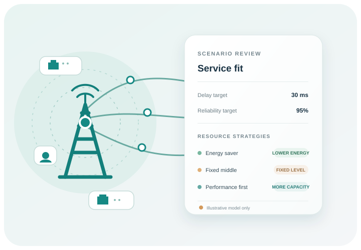

# ECHO-6G

[](https://github.com/abhinavannareddy/ECHO6G/actions/workflows/checks.yml)



ECHO-6G compares a service scenario with four network resource strategies. It shows how each option performs in a small model and lets you download the results as a CSV file.

This is an independent project. It is not made, sold, or approved by Ericsson.

## How it works


1. Enter traffic, channel quality, a delay limit, and a reliability target.
2. Compare four strategies using the same values.
3. Export the results and discuss any gaps with your supplier.

The tool highlights the lowest-energy option in its model that meets both targets. If none meet them, it says so and shows the highest-scoring option for review.

## The model and its data

The network model and benchmark are written in C++17. The Python code runs the web page and passes each request to the C++ engine.

There are no customer datasets or Ericsson product records in this project. The program makes repeatable training and test scenarios from a random seed. These values help check the software; they are not measurements from a real network.

The model uses simplified formulas for capacity, delay, reliability, and relative energy. It is not a 3GPP-compliant simulation and has not been checked against radio equipment. The energy value is not a power reading, price, or carbon estimate. There are no product listings, quotes, or ordering features. Use the results to prepare questions, not as the only basis for a purchase or deployment.

The formulas and assumptions are in [`docs/MODEL.md`](docs/MODEL.md). Example benchmark results and instructions are in [`results/RESULTS.md`](results/RESULTS.md).

## Run with Docker

Docker builds the C++ engine and starts the app. From this folder, run:

```powershell
docker compose up --build -d
```

Open <http://localhost:8080>. The app is available on your computer. Stop it with `docker compose down`.

To run the C++ and web checks without starting the app, run:

```powershell
docker build --target test -t echo6g-tests .
```

## Build and run without Docker

You need Python 3.10 or newer and a C++17 compiler. On Windows, open a Visual Studio Developer PowerShell, then run:

```powershell
python -m venv .venv
.\.venv\Scripts\Activate.ps1
New-Item -ItemType Directory -Force build\native
cl /std:c++17 /O2 /EHsc /I echo6g\native echo6g\native\main.cpp echo6g\native\engine.cpp /Fe:build\native\echo6g-engine.exe
$env:ECHO6G_ENGINE = (Resolve-Path build\native\echo6g-engine.exe).Path
python -m pip install -e .
python -m unittest discover -s tests -v
echo6g-web
```

Open <http://127.0.0.1:8080>. Press `Ctrl+C` to stop the app.

## Run the benchmark

The benchmark supports up to 10,000 scenarios. Each scenario is checked against all four strategies. After building the C++ engine, run:

```powershell
python -m echo6g.cli --output results --seed 2026 --scenarios 10000
```

The command writes `benchmark_results.csv` and `benchmark_summary.csv` under `results/`. These generated files are not included in the GitHub repository.

## Project files

- `echo6g/native/` — the C++ model, strategies, benchmark, and native checks.
- `echo6g/` — the Python web app and its C++ engine bridge.
- `echo6g/static/` — the page, styles, browser code, and illustrations.
- `tests/` — checks for model inputs, results, benchmark files, and the web app.
- `docs/MODEL.md` — a plain-language guide to the model and its limits.
- `results/RESULTS.md` — example results and how to read them.
- `CONTRIBUTORS.md` — the project contributor.
